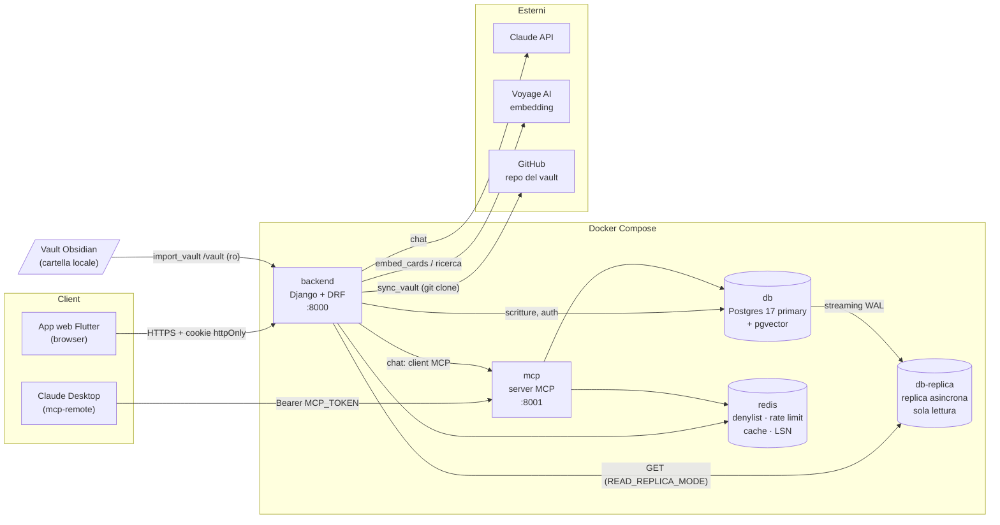
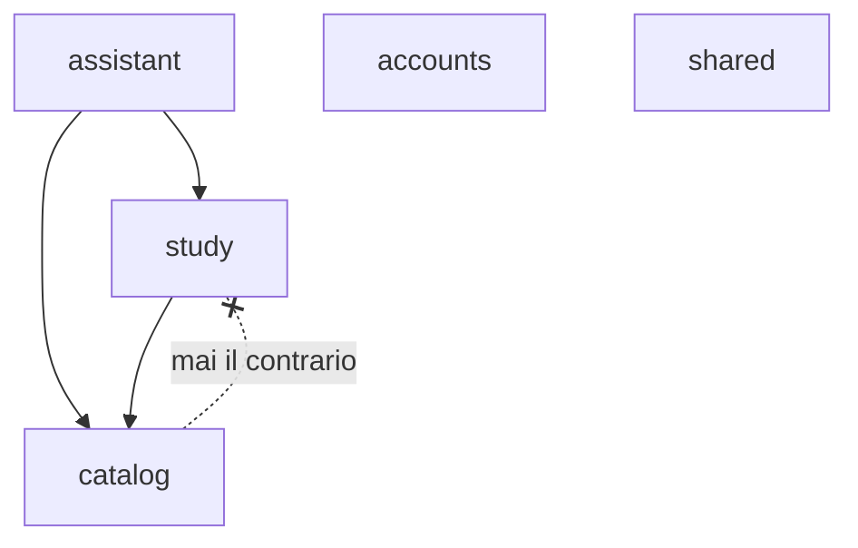
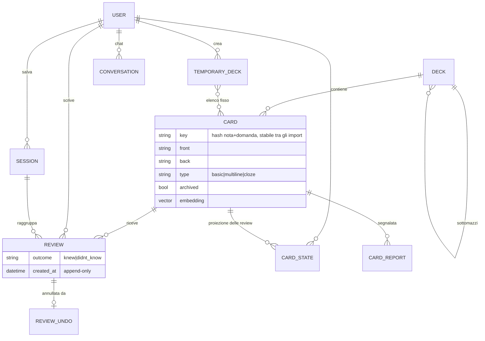
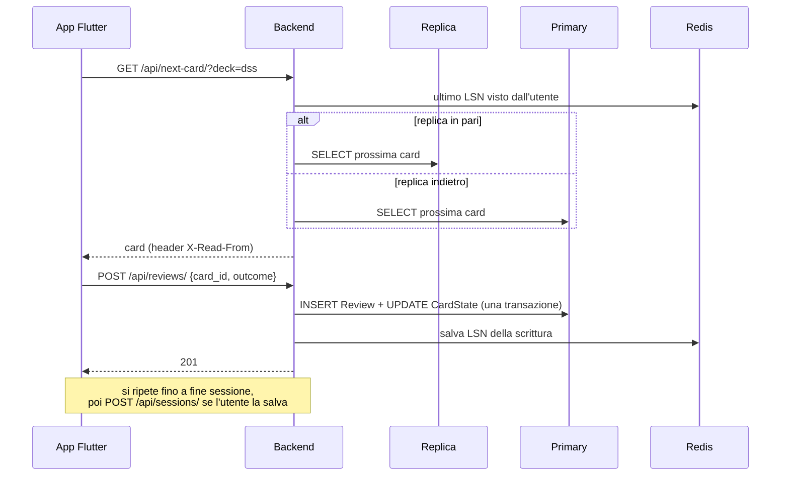
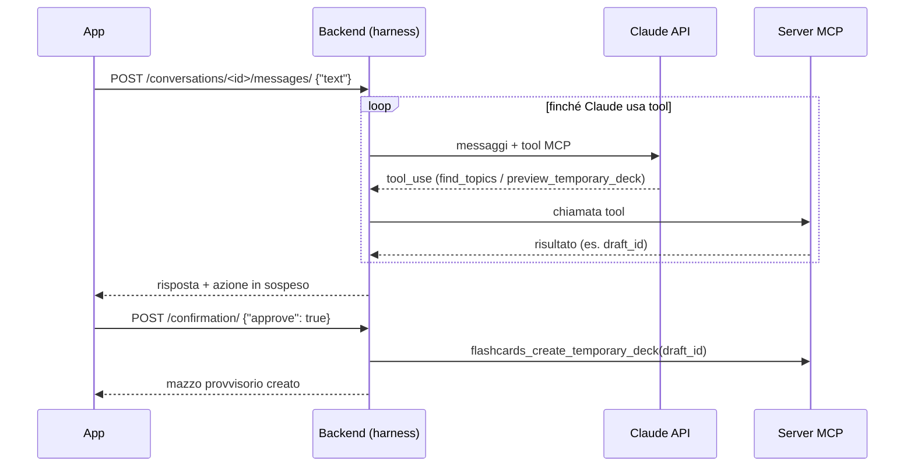
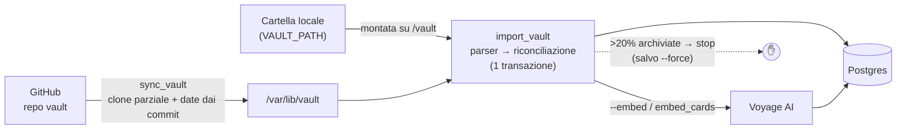
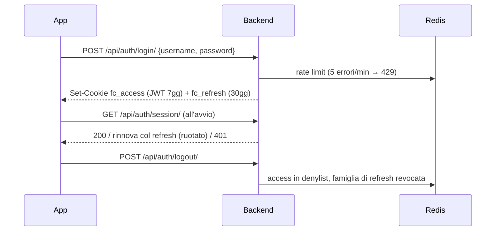
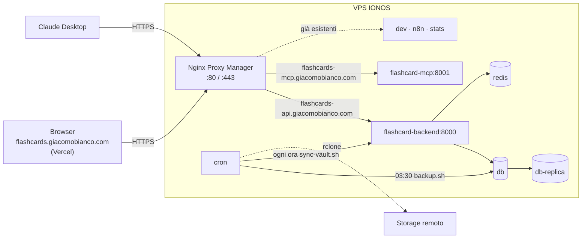

# FlashCardApp

App web per **ripassare le flashcard scritte nel vault Obsidian**. Le card restano nelle note del vault (unica fonte del contenuto): un backend Django le importa, le serve una alla volta all'app Flutter e registra le risposte ("Sapevo" / "Non sapevo"), con statistiche, sessioni salvate, ricerca testuale e semantica, e una chat con Claude che prepara mazzi di ripasso su misura.

Il progetto è anche una palestra di sistemi distribuiti: Postgres con replica asincrona, letture dalla replica con garanzie read-your-writes, Redis per cache e revoca dei token, un server MCP come servizio separato.

---

## Indice

1. [Cosa fa](#cosa-fa)
2. [Componenti](#componenti)
3. [System design](#system-design)
4. [Requisiti](#requisiti)
5. [Configurazione (`.env`)](#configurazione-env)
6. [Avvio in locale](#avvio-in-locale)
7. [Uso](#uso)
8. [Server MCP e chat](#server-mcp-e-chat)
9. [Replica Postgres](#replica-postgres)
10. [Test](#test)
11. [Build e deploy](#build-e-deploy) (con [deploy su VPS](#deploy-su-vps))
12. [Riferimento API](#riferimento-api)
13. [Glossario](#glossario)

---

## Cosa fa

- **Import dal vault** — legge le note `Flashcard -> <titolo>.md` (da cartella locale o da un repo GitHub) e ne estrae le card in tre formati:
  - `basic`: `Domanda::Risposta` su una riga;
  - `multiline`: domanda, una riga con solo `?`, risposta fino alla prima riga vuota;
  - `cloze`: una riga con lacune `==...==` (una card per lacuna).
  
  Il mazzo viene dal tag del frontmatter `flashcards/<mazzo>` o `flashcards/<mazzo>/<sottomazzo>`. L'import è idempotente: crea, aggiorna, archivia (card sparite dal vault) e ripristina.
- **Studio** — sceglie un mazzo, sottomazzo, nota o "Tutti"; il backend propone la prossima card (prima le mai viste, poi la vista meno di recente). Le risposte si possono annullare. A fine sessione si può salvarla.
- **Mazzi provvisori** — elenchi di card scelti con filtri (note, modificate oggi, sbagliate di recente), validi fino a mezzanotte.
- **Statistiche** — risposte di oggi, giorni consecutivi, andamento per mazzo.
- **Ricerca** — testuale e semantica (embedding Voyage AI + pgvector: "consenso" trova le card su Raft).
- **Segnalazioni** — marca una card da correggere nel vault.
- **Chat di ripasso** — chat con Claude che, tramite i tool MCP, trova gli argomenti e propone un mazzo provvisorio da confermare. Gli stessi tool sono usabili da Claude Desktop.

## Componenti

| Componente | Tecnologia | Cartella | Ruolo |
|---|---|---|---|
| **App web** | Flutter (web), architettura Pine, BLoC/Cubit, auto_route | `flashcard/` | UI di studio, statistiche, ricerca, chat |
| **Backend API** | Django 5.2 + DRF, gunicorn | `backend/` | API REST, import, autenticazione, admin |
| **Server MCP** | SDK `mcp` (Streamable HTTP), stesso codice del backend | `backend/apps/assistant/mcp/` | Tool per creare mazzi provvisori da una chat |
| **Postgres primary** | Postgres 17 + pgvector | `db/` | Dati e embedding, tutte le scritture |
| **Postgres replica** | Replica fisica asincrona (streaming) | `db/replica-entrypoint.sh` | Letture GET dell'API |
| **Redis** | Redis 7 | — | Denylist JWT, rate limit login, cache, marcatori LSN per la replica |
| **Servizi esterni** | Claude API, Voyage AI, GitHub | — | Chat, embedding, vault remoto |

### Backend: bounded context

Ogni context è diviso in layer `models → repositories → services → api`.

| Context | Possiede |
|---|---|
| `catalog` | Mazzi, card, parser del vault, import/sync, embedding, ricerca, segnalazioni |
| `study` | Review (append-only), CardState, prossima card, mazzi provvisori, sessioni salvate |
| `accounts` | Utenti, login, JWT in cookie httpOnly, refresh token ruotati |
| `assistant` | Server MCP e chat dell'app (conversazioni, harness con la Claude API) |
| `shared` | Router del DB (primary/replica), cache Redis, middleware di consistenza delle letture |

### App Flutter: layer Pine

```
lib/
├── network/          service HTTP, DTO, interceptor (CSRF, sessione, sorgente di lettura)
├── mappers/          DTO ⇄ entità di dominio
├── model/            entità
├── repositories/     interfacce + impl
├── state_management/ cubit (auth, decks, study_session, chat, stats, …)
├── ui/               pagine e widget
├── di/               dependency injection
└── routers/          auto_route (app_router.gr.dart è generato)
```

---

## System design

### Architettura



### Dipendenze tra context



Le letture di `catalog` tollerano una replica in ritardo; quelle di `study` no: per questo esiste la modalità `lsn`.

### Modello dei dati



### Flusso di studio



### Chat di ripasso (Claude + MCP)



### Import / sync del vault



### Autenticazione



Le richieste che scrivono devono avere l'header `X-Requested-With` (protezione CSRF). Un refresh token già usato che ricompare revoca l'intera famiglia.

---

## Requisiti

- **Docker** + Docker Compose
- **Flutter SDK** (stabile, Dart 3) con Chrome, per l'app
- Un **vault Obsidian** con note `Flashcard -> *.md` (cartella locale o repo GitHub)
- Opzionali: chiave **Claude API** (chat), chiave **Voyage AI** (ricerca semantica), token **GitHub** (sync da repo), Node/`npx` (Claude Desktop)

---

## Configurazione (`.env`)

```bash
cp .env.example .env
```

`.env` non va mai committato. Variabili:

| Variabile | Obbligatoria | Descrizione |
|---|---|---|
| `DJANGO_SECRET_KEY` | ✅ | Chiave segreta Django |
| `DJANGO_DEBUG` | | `true` in locale |
| `DJANGO_ALLOWED_HOSTS` | ✅ | Es. `localhost,127.0.0.1` |
| `POSTGRES_DB`, `POSTGRES_USER`, `POSTGRES_PASSWORD` | ✅ | Credenziali del DB |
| `POSTGRES_REPLICATION_USER`, `POSTGRES_REPLICATION_PASSWORD` | ✅ | Utente della replica. Usati solo alla **prima** inizializzazione del volume: per cambiarli dopo serve `\password` in psql |
| `READ_REPLICA_MODE` | | `off` (solo primary), `always` (GET dalla replica anche in ritardo), `lsn` (replica solo se in pari con l'utente) |
| `REPLICA_APPLY_DELAY` | | Ritardo artificiale della replica (es. `5s`) per sperimentare il lag |
| `VAULT_PATH` | ✅ | Percorso assoluto del vault locale, montato in sola lettura su `/vault` |
| `JWT_SIGNING_KEY` | ✅ | Chiave lunga e casuale per firmare i JWT |
| `AUTH_COOKIE_SECURE` | | `false` solo in locale su http; `true` in produzione |
| `CORS_ALLOWED_ORIGINS` | ✅ | Origini dell'app web, es. `http://localhost:5173` |
| `MCP_TOKEN` | per MCP | Token statico del server MCP: `python3 -c "import secrets; print(secrets.token_urlsafe(32))"` |
| `MCP_USERNAME` | per MCP | Utente per cui agiscono i tool MCP |
| `ANTHROPIC_API_KEY` | per la chat | Chiave Claude API (platform.claude.com) |
| `ASSISTANT_MODEL`, `ASSISTANT_EFFORT` | | Modello ed effort della chat (default `claude-opus-5-5`, `medium`) |
| `VOYAGE_API_KEY` | per la ricerca semantica | Senza, la ricerca per significato è disattivata |
| `SEMANTIC_MIN_SIMILARITY` | | Soglia di similarità (default `0.45`) |
| `VAULT_GIT_URL`, `VAULT_GIT_BRANCH`, `VAULT_GIT_TOKEN` | per `sync_vault` | Repo del vault; token fine-grained con solo "Contents: Read-only" |
| `STUDY_TIME_ZONE` | | Fuso per statistiche e scadenze (default `Europe/Rome`) |

Avanzate (hanno un default sensato): `ACCESS_TOKEN_LIFETIME_SECONDS`, `REFRESH_TOKEN_LIFETIME_SECONDS`, `LOGIN_RATE_LIMIT`, `LOGIN_RATE_WINDOW_SECONDS`, `DJANGO_CONN_MAX_AGE`, `EMBEDDINGS_MODEL`, `MCP_PUBLIC_URL`, `MCP_INTERNAL_URL`, `MCP_ISSUER_URL`, `MCP_ALLOWED_HOSTS`, `VAULT_GIT_DIR`, `DJANGO_LOG_LEVEL`, `DJANGO_HSTS_SECONDS`, `DJANGO_HSTS_INCLUDE_SUBDOMAINS`. Per la produzione vedi [Deploy su VPS](#deploy-su-vps). `POSTGRES_HOST`, `POSTGRES_REPLICA_HOSTS` e `REDIS_URL` li imposta già il compose.

**App Flutter**: crea `flashcard/dart_defines.env` (ignorato da git):

```
API_BASE_URL=http://localhost:8000
```

---

## Avvio in locale

```bash
# 1. Backend + DB + replica + Redis (migrazioni automatiche all'avvio)
docker compose up -d --build
curl localhost:8000/api/health/                 # 200 se il DB risponde

# 2. Utente (nessuna registrazione: si creano da comando)
docker compose exec backend python manage.py create_user giacomo           # chiede la password
docker compose exec backend python manage.py create_user giacomo --admin   # anche accesso a /admin/

# 3. Card: dal vault locale...
docker compose exec backend python manage.py import_vault /vault
#    ...oppure da GitHub (serve VAULT_GIT_*), con embedding
docker compose run --rm backend python manage.py sync_vault --embed

# 4. App web (porta = quella in CORS_ALLOWED_ORIGINS)
cd flashcard
flutter pub get
flutter run -d chrome --web-port 5173 --dart-define-from-file=dart_defines.env
```

Se modifichi le route di `auto_route`, rigenera il codice: `dart run build_runner build --delete-conflicting-outputs`.

Il codice del backend è montato come volume: gunicorn si ricarica a ogni modifica. Dopo aver cambiato il `.env`: `docker compose up -d backend`.

---

## Uso

- **Login** con l'utente creato; l'autologin usa i cookie e i suggerimenti di scadenza salvati nel browser.
- **Mazzi** → scegli mazzo, sottomazzo o argomento (nota) e la lunghezza della sessione (10, 20, 50, tutte).
- **Studio** — scorciatoie da tastiera su desktop:

  | Tasto | Azione |
  |---|---|
  | Spazio / Invio | Gira la card |
  | → / K | Sapevo |
  | ← / J | Non sapevo |
  | Z / Backspace | Annulla l'ultima risposta |
  | Esc | Chiude la sessione |

- **Riepilogo** → salva o scarta la sessione (le review restano comunque).
- **Statistiche**, **Ricerca**, **Sessioni salvate**, **Segnalazioni**, **Chat di ripasso**, **Impostazioni** (sync del vault per gli staff, apertura delle note in Obsidian).
- **Admin Django** su `http://localhost:8000/admin/` per gli utenti `--admin`.

### Comandi di gestione

| Comando | Cosa fa |
|---|---|
| `import_vault <percorso>` | Riconcilia il DB con il vault (idempotente, una transazione) |
| `sync_vault [--embed] [--force]` | Aggiorna il clone GitHub e importa; si ferma se archivierebbe >20% delle card |
| `embed_cards` | Calcola gli embedding mancanti |
| `semantic_search "<testo>"` | Prova la ricerca semantica mostrando le similarità |
| `create_user <nome> [--admin]` | Crea un utente |
| `mcp_server --port 8001` | Avvia il server MCP (lo fa il servizio `mcp`) |

Esegui con `docker compose exec backend python manage.py <comando>`.

---

## Server MCP e chat

```bash
docker compose up -d mcp
curl localhost:8001/health          # {"status":"ok"}
```

Tool esposti su `http://localhost:8001/mcp`: `flashcards_find_topics`, `flashcards_preview_temporary_deck` (anteprima → `draft_id`), `flashcards_create_temporary_deck`, `flashcards_list_temporary_decks`. Servono `MCP_TOKEN` e `MCP_USERNAME`.

**Claude Desktop** (`~/Library/Application Support/Claude/claude_desktop_config.json`):

```json
"mcpServers": {
  "flashcardapp": {
    "command": "/opt/homebrew/bin/npx",
    "args": ["-y", "mcp-remote@0.14.3", "http://localhost:8001/mcp", "--header", "Authorization:${MCP_AUTH}"],
    "env": {"MCP_AUTH": "Bearer <MCP_TOKEN>"}
  }
}
```

**Chat dell'app**: il backend fa da client MCP e chiama la Claude API; serve `ANTHROPIC_API_KEY` e il servizio `mcp` attivo.

---

## Replica Postgres

Al primo avvio da volumi vuoti `db/init-primary.sh` crea utente e slot di replica, e `db/replica-entrypoint.sh` fa il base backup. Il backend sceglie da dove leggere con `READ_REPLICA_MODE`; in modalità `lsn` ogni utente è legato sempre alla stessa replica (rendezvous hashing) e legge da lì solo se ha già raggiunto la sua ultima posizione (read-your-writes e monotonic reads). Scritture, autenticazione e letture in transazione vanno sempre al primary. L'header di risposta `X-Read-From` dice chi ha risposto.

```bash
# Stato della replica e lag
docker compose exec db sh -c 'psql -U "$POSTGRES_USER" -d "$POSTGRES_DB" -c "select client_addr, state, sent_lsn, replay_lsn, replay_lag from pg_stat_replication"'
# Ricreare la replica da zero
docker compose rm -sf db-replica && docker volume rm flashcardapp_pgreplica && docker compose up -d db-replica
# Slot invalidato (wal_status = lost): ricrealo con la replica spenta
docker compose exec db sh -c 'psql -U "$POSTGRES_USER" -d "$POSTGRES_DB" -c "select pg_drop_replication_slot(\$\$flashcard_replica\$\$)" -c "select pg_create_physical_replication_slot(\$\$flashcard_replica\$\$)"'
```

I limiti di memoria del compose (Postgres 256 MB, backend 192 MB, …) sono pensati per una VM da ~2 GB.

---

## Test

```bash
docker compose run --rm backend pytest     # backend, su Postgres vero
cd flashcard && flutter test               # app: repository, cubit, interceptor, widget
```

---

## Build e deploy

### Deploy su VPS

Il backend va sulla VPS IONOS (`ssh vps`, utente `jackwhite`), dove girano già **Nginx Proxy Manager** (porte 80/443, pannello su `:81`), un altro progetto Django, n8n e Netdata. Per questo lo stack di produzione **non espone porte sull'host** (niente conflitti con la porta 8000 dell'altro progetto): backend e MCP entrano nella rete Docker di Nginx Proxy Manager (`PROXY_NETWORK`) con i nomi `flashcard-backend` e `flashcard-mcp`, e NPM gestisce HTTPS e certificati. L'app Flutter va su Vercel.



| File | Cosa fa |
|---|---|
| `docker-compose.prod.yml` | Stack di produzione: codice nell'immagine, senza dipendenze di test, `restart: unless-stopped`, log ruotati, nessuna porta pubblicata |
| `deploy/deploy.sh` | `git pull` + build + riavvio dei servizi |
| `deploy/install-cron.sh` | Una tantum, con sudo: cron di backup notturno e sync orario del vault |
| `deploy/backup.sh` | `pg_dump` compresso in `BACKUP_DIR`, conserva `BACKUP_KEEP_DAYS` giorni, copia su `BACKUP_RCLONE_REMOTE` se impostato |
| `deploy/restore.sh <file>` | Ripristina un backup (chiede conferma, ferma backend e mcp) |
| `deploy/sync-vault.sh` | `sync_vault --embed` |

**1. DNS** — record A verso `217.154.117.202` per `flashcards-api.giacomobianco.com` e `flashcards-mcp.giacomobianco.com`; su Vercel il dominio `flashcards.giacomobianco.com`. App e API devono stare sotto `giacomobianco.com`: i cookie sono `SameSite=Lax` e il browser non li manda tra siti diversi.

**2. Rete di Nginx Proxy Manager** — sulla VPS:

```bash
docker network ls                                   # trova la rete del container di NPM
docker inspect <container-npm> --format '{{range $k,$v := .NetworkSettings.Networks}}{{$k}} {{end}}'
```

Metti quel nome in `PROXY_NETWORK` nel `.env`.

**3. Installazione**

```bash
ssh vps
git clone <repo> ~/flashcardapp && cd ~/flashcardapp
cp .env.example .env && nano .env
deploy/deploy.sh
docker compose -f docker-compose.prod.yml exec backend python manage.py create_user giacomo --admin
deploy/sync-vault.sh
sudo deploy/install-cron.sh
```

**4. Proxy host in Nginx Proxy Manager** (`http://217.154.117.202:81`), con SSL Let's Encrypt, "Force SSL" e "HTTP/2":

| Domain | Forward | Note |
|---|---|---|
| `flashcards-api.giacomobianco.com` | `http` · `flashcard-backend` · `8000` | Advanced: `proxy_read_timeout 1800s; proxy_send_timeout 1800s;` (chat e sync lunghi) |
| `flashcards-mcp.giacomobianco.com` | `http` · `flashcard-mcp` · `8001` | Advanced: `proxy_buffering off; proxy_read_timeout 600s;` |

**`.env` di produzione**, oltre ai valori della tabella di [Configurazione](#configurazione-env):

| Variabile | Valore |
|---|---|
| `DJANGO_SECRET_KEY`, `JWT_SIGNING_KEY`, `POSTGRES_PASSWORD`, `POSTGRES_REPLICATION_PASSWORD`, `MCP_TOKEN` | Nuovi e casuali: `python3 -c "import secrets; print(secrets.token_urlsafe(48))"` |
| `DJANGO_ALLOWED_HOSTS` | `flashcards-api.giacomobianco.com,flashcard-backend,localhost` |
| `DJANGO_CSRF_TRUSTED_ORIGINS` | `https://flashcards-api.giacomobianco.com` (serve all'admin) |
| `DJANGO_ADMIN_URL` | Un percorso non ovvio, es. `gestione-x7k2/` (default `admin/`) |
| `CORS_ALLOWED_ORIGINS` | `https://flashcards.giacomobianco.com` |
| `PROXY_NETWORK` | La rete di Nginx Proxy Manager (passo 2) |
| `MCP_PUBLIC_URL` | `https://flashcards-mcp.giacomobianco.com/mcp` |
| `MCP_ISSUER_URL` | `https://flashcards-api.giacomobianco.com` |
| `MCP_ALLOWED_HOSTS` | `flashcards-mcp.giacomobianco.com,mcp:*` |
| `VAULT_GIT_URL`, `VAULT_GIT_TOKEN` | Repo del vault |
| `BACKUP_RCLONE_REMOTE` | Es. `b2:flashcard-backup` dopo `rclone config` (vuoto = solo backup locali) |

`DJANGO_DEBUG=false` e `AUTH_COOKIE_SECURE=true` li forza il compose di produzione; `VAULT_PATH` non serve. Postgres e Redis restano nella rete interna dello stack: non toccano il Postgres dell'altro progetto.

**Memoria** — i limiti dello stack sommano ~1 GB (Postgres 256 MB + replica 256 MB + backend 192 MB + mcp 160 MB + Redis 64 MB), da affiancare agli altri servizi della VPS: controlla con Netdata. Se serve spazio, si può togliere `db-replica` con `READ_REPLICA_MODE=off`.

**Operazioni**

```bash
deploy/deploy.sh                                                    # aggiornare dopo un push
docker compose -f docker-compose.prod.yml logs -f backend           # log
deploy/backup.sh                                                    # backup manuale
deploy/restore.sh /var/backups/flashcardapp/flashcards-<data>.sql.gz
```

Claude Desktop in produzione: nella configurazione MCP usa `https://flashcards-mcp.giacomobianco.com/mcp`. Netdata (`stats.giacomobianco.com`) monitora già la VPS; per l'uptime basta un controllo su `https://flashcards-api.giacomobianco.com/api/health/`.

### App web

```bash
cd flashcard
tool/build_web.sh https://flashcards-api.giacomobianco.com   # build ottimizzata in build/web
tool/subset_fonts.sh                          # solo se cambiano i font
cd build/web && npx vercel --prod             # vercel.json già incluso (fallback SPA, service worker)
```

`build_web.sh` serve CanvasKit dal dominio dell'app e carica i font di KaTeX dopo il primo frame; `web/index.html` anticipa le prime chiamate API mentre Flutter si avvia.

---

## Riferimento API

Tutte autenticate dal cookie, tranne health e login.

| Metodo | Percorso | Cosa fa |
|---|---|---|
| GET | `/api/health/` | Stato del backend e del DB |
| POST | `/api/auth/login/` | Imposta i cookie; 429 dopo 5 errori al minuto |
| GET | `/api/auth/session/` | Autologin: conferma o rinnova; 401 senza sessione, 409 se un'altra scheda sta rinnovando |
| POST | `/api/auth/logout/` | Revoca i token e cancella i cookie |
| GET | `/api/decks/` | Mazzi con sottomazzi, card attive e mai viste |
| PATCH | `/api/decks/<slug>/` | `{"name"}`: rinomina (l'import non lo sovrascrive) |
| GET | `/api/decks/<slug>/notes/` | Argomenti del mazzo |
| GET | `/api/next-card/?deck=&note=&temporary_deck=&exclude=` | Una card; `{"card": null}` se finite |
| POST | `/api/reviews/` | `{"card_id", "outcome": "knew"\|"didnt_know"}` |
| POST | `/api/reviews/<id>/undo/` | Annulla una review (409 se già annullata) |
| GET · POST | `/api/sessions/` | Sessioni salvate; salvarne una |
| GET | `/api/stats/` | Statistiche |
| GET | `/api/cards/search/?q=&deck=` | Ricerca testuale (max 50) |
| POST | `/api/cards/<id>/reports/` | `{"reason": "wrong_answer"\|"bad_format"\|"other", "comment"}` |
| GET · POST | `/api/reports/` · `/api/reports/<id>/resolve/` | Segnalazioni aperte; risolverne una |
| POST | `/api/vault/sync/` | Solo staff: sync da GitHub + embedding (200, 207 se gli embedding falliscono) |
| GET · POST | `/api/conversations/` | Chat: elenco / nuova |
| GET · DELETE | `/api/conversations/<id>/` | Una chat |
| POST | `/api/conversations/<id>/messages/` | `{"text"}`: un turno; 409 se attende conferma |
| POST | `/api/conversations/<id>/confirmation/` | `{"approve": bool}` |

---

## Glossario

- **Vault** — il vault Obsidian, unica fonte del contenuto; l'app non modifica mai le card.
- **Nota** — file `Flashcard -> <titolo>.md`; le altre note sono ignorate.
- **Mazzo / Sottomazzo** — dal tag `flashcards/<mazzo>[/<sottomazzo>]`; studiare un mazzo include i sottomazzi.
- **Chiave della card** — hash di titolo nota + domanda normalizzata (per le cloze: riga + indice della lacuna); identifica la card tra un import e l'altro.
- **Card archiviata** — sparita dal vault: non proposta, ma conserva lo storico; torna attiva se ricompare.
- **Review** — una risposta, append-only. L'**annullamento** è un evento di compensazione, non una cancellazione.
- **CardState** — proiezione delle review valide (ultima vista, conteggi), aggiornata nella stessa transazione.
- **Prossima card** — prima le mai viste, poi la meno recente, a parità casuale; una alla volta.
- **Mazzo provvisorio** — elenco fisso di card scelte con filtri, scade a mezzanotte, non compare nelle statistiche.
- **Sessione** — una serie di card dalla scelta al riepilogo; salvata solo se l'utente conferma.
- **Embedding** — vettore di titolo + fronte + retro per la ricerca semantica; si ricalcola con `embed_cards` dopo l'import.
