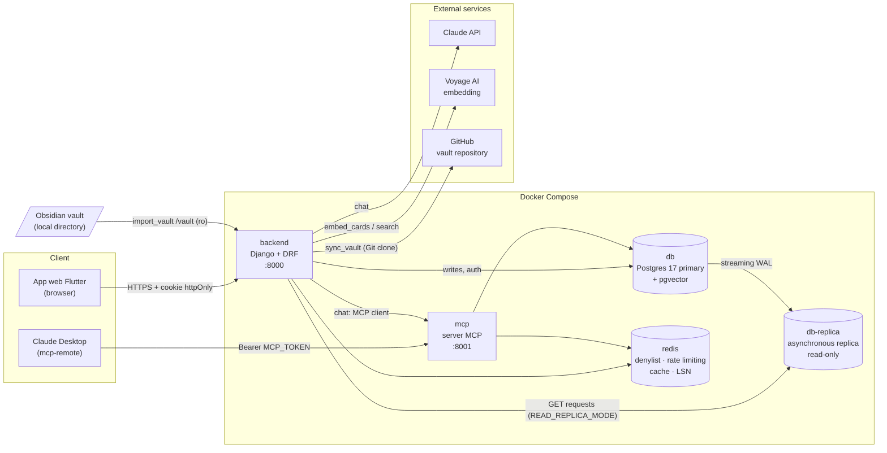
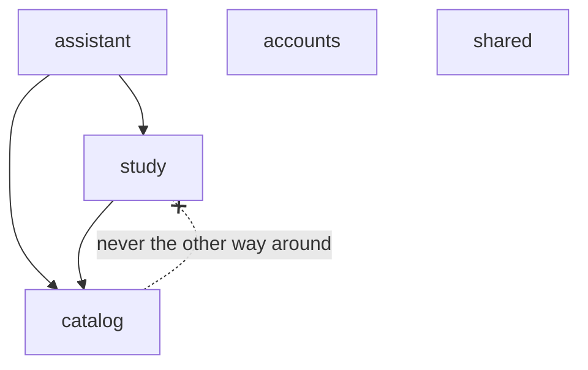
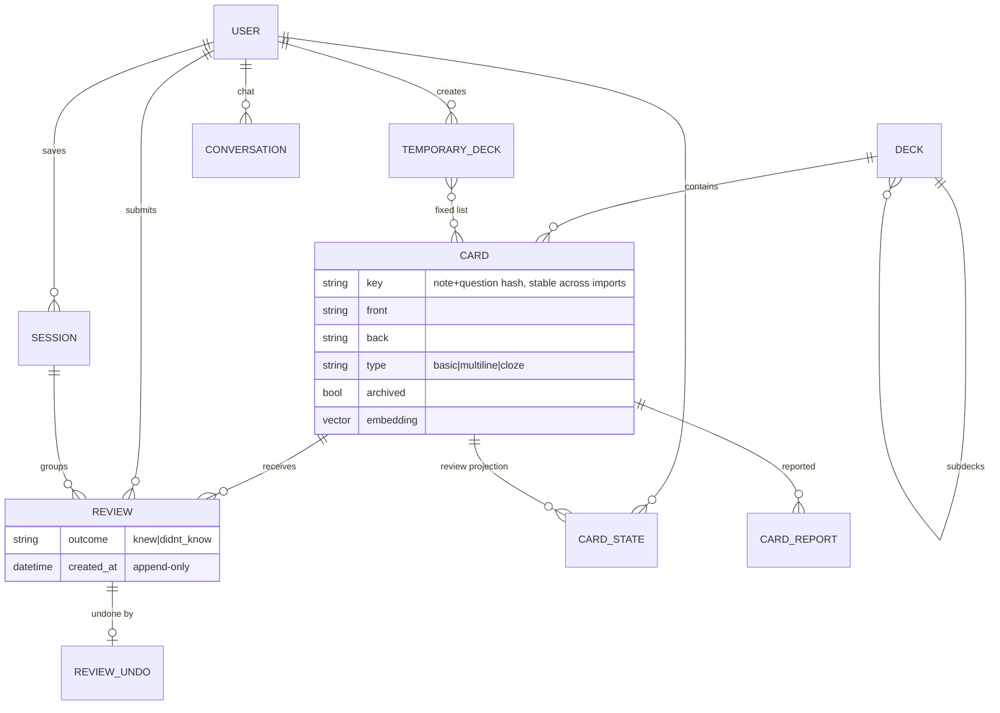
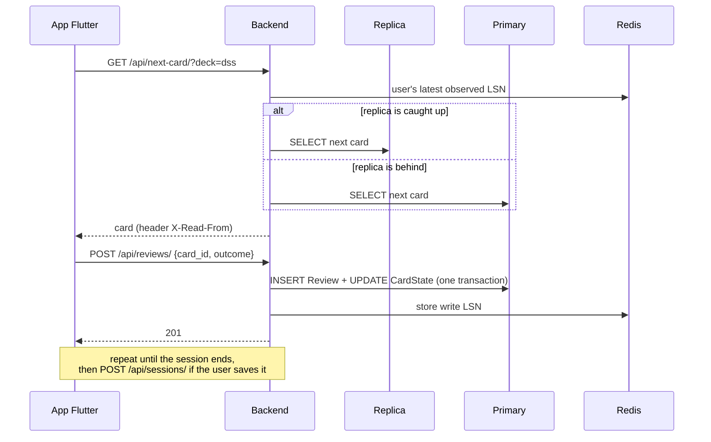
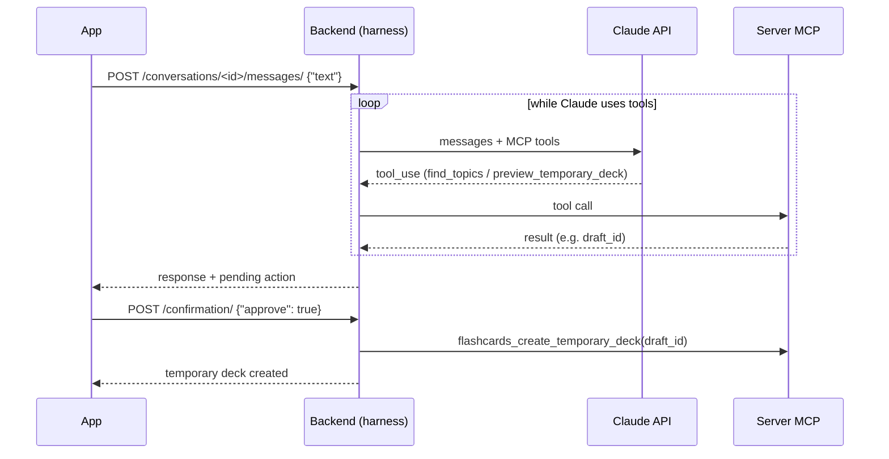
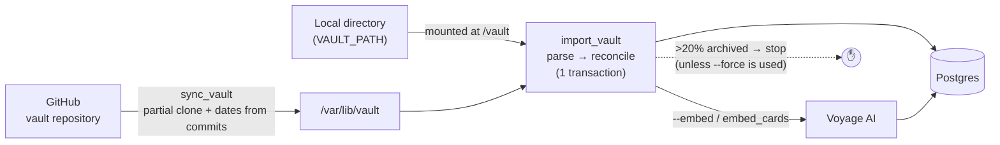
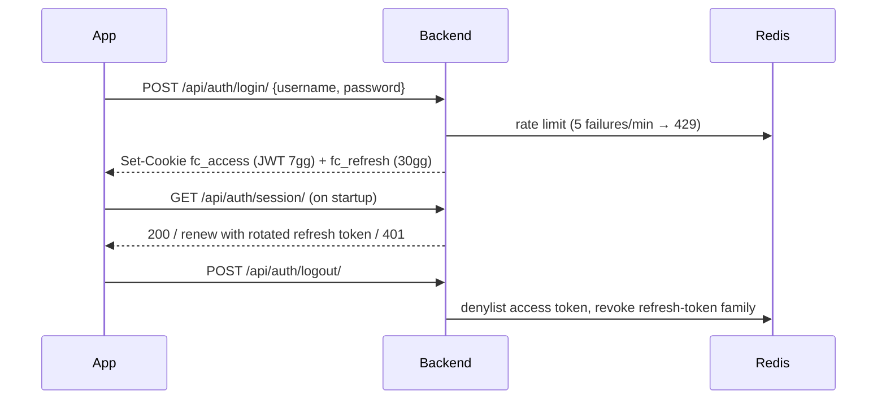

# FlashCardApp

Web app for **reviewing flashcards stored in an Obsidian vault**. Cards remain in the vault notes—the single source of truth—while a Django backend imports them, serves them one at a time to the Flutter app, and records the answers ("Knew it" / "Didn't know it"). It also provides statistics, saved sessions, full-text and semantic search, and a Claude-powered chat that creates tailored review decks.

The project also serves as a distributed-systems playground: PostgreSQL with asynchronous replication, replica reads with read-your-writes guarantees, Redis for caching and token revocation, and a standalone MCP server.

---

## Table of contents

1. [Features](#features)
2. [Components](#components)
3. [System design](#system-design)
4. [Requirements](#requirements)
5. [Configuration (`.env`)](#configuration-env)
6. [Local setup](#local-setup)
7. [Usage](#usage)
8. [MCP server and chat](#mcp-server-and-chat)
9. [PostgreSQL replication](#postgresql-replication)
10. [Tests](#tests)
11. [Build and deployment](#build-and-deployment) (including [VPS deployment](#vps-deployment))
12. [API reference](#api-reference)
13. [Glossary](#glossary)

---

## Features

- **Vault import** — reads `Flashcard -> <title>.md` notes from a local directory or GitHub repository and extracts cards in three formats:
  - `basic`: `Question::Answer` on a single line;
  - `multiline`: a question, a line containing only `?`, then the answer up to the first blank line;
  - `cloze`: a line containing `==...==` blanks (one card per blank).
  
  The deck is determined by the `flashcards/<deck>` or `flashcards/<deck>/<subdeck>` frontmatter tag. Imports are idempotent: they create, update, archive cards removed from the vault, and restore cards that reappear.
- **Study sessions** — choose a deck, subdeck, note, or "All". The backend selects the next card—unseen cards first, followed by the least recently viewed. Answers can be undone, and completed sessions can be saved.
- **Temporary decks** — filtered card lists based on notes, cards modified today, or recently missed cards; valid until midnight.
- **Statistics** — today's answers, study streaks, and progress by deck.
- **Search** — full-text and semantic search using Voyage AI embeddings and pgvector; for example, "consensus" can find cards about Raft.
- **Reports** — flag cards that need to be corrected in the vault.
- **Review chat** — Claude uses MCP tools to find topics and propose a temporary review deck for confirmation. The same tools can be used from Claude Desktop.

## Components

| Component | Technology | Directory | Purpose |
|---|---|---|---|
| **Web app** | Flutter web, Pine architecture, BLoC/Cubit, auto_route | `flashcard/` | Study UI, statistics, search, and chat |
| **API backend** | Django 5.2 + DRF, Gunicorn | `backend/` | REST API, imports, authentication, and admin |
| **MCP server** | `mcp` SDK (Streamable HTTP), shared backend codebase | `backend/apps/assistant/mcp/` | Tools for creating temporary decks from a chat |
| **Primary PostgreSQL** | PostgreSQL 17 + pgvector | `db/` | Data, embeddings, and all writes |
| **PostgreSQL replica** | Asynchronous physical streaming replica | `db/replica-entrypoint.sh` | API GET reads |
| **Redis** | Redis 7 | — | JWT denylist, login rate limiting, cache, and replica LSN markers |
| **External services** | Claude API, Voyage AI, GitHub | — | Chat, embeddings, and remote vault sync |

### Backend: bounded context

Each context is split into `models → repositories → services → api` layers.

| Context | Owns |
|---|---|
| `catalog` | Decks, cards, vault parser, import/sync, embeddings, search, and reports |
| `study` | Append-only reviews, CardState, next-card selection, temporary decks, and saved sessions |
| `accounts` | Users, login, JWTs in HTTP-only cookies, and rotated refresh tokens |
| `assistant` | MCP server and in-app chat, including conversations and the Claude API harness |
| `shared` | Primary/replica DB router, Redis cache, and read-consistency middleware |

### Flutter app: Pine layers

```
lib/
├── network/          HTTP services, DTOs, interceptors (CSRF, session, read source)
├── mappers/          DTO ⇄ domain entity mapping
├── model/            domain entities
├── repositories/     interfaces + implementations
├── state_management/ cubits (auth, decks, study_session, chat, stats, …)
├── ui/               pages and widgets
├── di/               dependency injection
└── routers/          auto_route (app_router.gr.dart is generated)
```

---

## System design

### Architecture



### Context dependencies



`catalog` reads can tolerate replication lag, while `study` reads cannot. This is why the `lsn` mode exists.

### Data model



### Study flow



### Review chat (Claude + MCP)



### Vault import and sync



### Authentication



Write requests must include the `X-Requested-With` header for CSRF protection. Reusing an already-consumed refresh token revokes the entire token family.

---

## Requirements

- **Docker** and Docker Compose
- The stable **Flutter SDK** with Dart 3 and Chrome for the web app
- An **Obsidian vault** containing `Flashcard -> *.md` notes, either locally or in a GitHub repository
- Optional: a **Claude API** key for chat, a **Voyage AI** key for semantic search, a **GitHub** token for repository sync, and Node/`npx` for Claude Desktop

---

## Configuration (`.env`)

```bash
cp .env.example .env
```

Never commit `.env`. Available variables:

| Variable | Required | Description |
|---|---|---|
| `DJANGO_SECRET_KEY` | ✅ | Django secret key |
| `DJANGO_DEBUG` | | Set to `true` for local development |
| `DJANGO_ALLOWED_HOSTS` | ✅ | For example, `localhost,127.0.0.1` |
| `POSTGRES_DB`, `POSTGRES_USER`, `POSTGRES_PASSWORD` | ✅ | Database credentials |
| `POSTGRES_REPLICATION_USER`, `POSTGRES_REPLICATION_PASSWORD` | ✅ | Replication user. Used only when the volume is initialized for the **first time**; changing them later requires `\password` in psql |
| `READ_REPLICA_MODE` | | `off` (primary only), `always` (GET requests use the replica even when it is behind), or `lsn` (use the replica only when it has caught up with the user) |
| `REPLICA_APPLY_DELAY` | | Artificial replica delay, such as `5s`, for experimenting with replication lag |
| `VAULT_PATH` | ✅ | Absolute path to the local vault, mounted read-only at `/vault` |
| `JWT_SIGNING_KEY` | ✅ | Long, random key used to sign JWTs |
| `AUTH_COOKIE_SECURE` | | Use `false` only for local HTTP development and `true` in production |
| `CORS_ALLOWED_ORIGINS` | ✅ | Web app origins, for example `http://localhost:5173` |
| `MCP_TOKEN` | For MCP | Static MCP server token: `python3 -c "import secrets; print(secrets.token_urlsafe(32))"` |
| `MCP_USERNAME` | For MCP | User on whose behalf the MCP tools operate |
| `ANTHROPIC_API_KEY` | For chat | Claude API key from platform.claude.com |
| `ASSISTANT_MODEL`, `ASSISTANT_EFFORT` | | Chat model and effort level; defaults to `claude-opus-5-5` and `medium` |
| `VOYAGE_API_KEY` | For semantic search | Semantic search is disabled when this is not set |
| `SEMANTIC_MIN_SIMILARITY` | | Similarity threshold; defaults to `0.45` |
| `VAULT_GIT_URL`, `VAULT_GIT_BRANCH`, `VAULT_GIT_TOKEN` | For `sync_vault` | Vault repository and a fine-grained token with only "Contents: Read-only" access |
| `STUDY_TIME_ZONE` | | Time zone used for statistics and expirations; defaults to `Europe/Rome` |

Advanced variables with sensible defaults: `ACCESS_TOKEN_LIFETIME_SECONDS`, `REFRESH_TOKEN_LIFETIME_SECONDS`, `LOGIN_RATE_LIMIT`, `LOGIN_RATE_WINDOW_SECONDS`, `DJANGO_CONN_MAX_AGE`, `EMBEDDINGS_MODEL`, `MCP_PUBLIC_URL`, `MCP_INTERNAL_URL`, `MCP_ISSUER_URL`, `MCP_ALLOWED_HOSTS`, `VAULT_GIT_DIR`, `DJANGO_LOG_LEVEL`, `DJANGO_HSTS_SECONDS`, and `DJANGO_HSTS_INCLUDE_SUBDOMAINS`. See [VPS deployment](#vps-deployment) for production configuration. Docker Compose already sets `POSTGRES_HOST`, `POSTGRES_REPLICA_HOSTS`, and `REDIS_URL`.

**Flutter app:** create `flashcard/dart_defines.env` (ignored by Git):

```
API_BASE_URL=http://localhost:8000
```

---

## Local setup

```bash
# 1. Backend + database + replica + Redis (migrations run automatically on startup)
docker compose up -d --build
curl localhost:8000/api/health/                 # 200 if the database is available

# 2. User (there is no sign-up page; users are created from the command line)
docker compose exec backend python manage.py create_user giacomo           # prompts for a password
docker compose exec backend python manage.py create_user giacomo --admin   # also grants /admin/ access

# 3. Cards: import from the local vault...
docker compose exec backend python manage.py import_vault /vault
#    ...or from GitHub (requires VAULT_GIT_*), including embeddings
docker compose run --rm backend python manage.py sync_vault --embed

# 4. Web app (the port must match CORS_ALLOWED_ORIGINS)
cd flashcard
flutter pub get
flutter run -d chrome --web-port 5173 --dart-define-from-file=dart_defines.env
```

After changing `auto_route` routes, regenerate the code with `dart run build_runner build --delete-conflicting-outputs`.

The backend source is mounted as a volume, so Gunicorn reloads after every change. After changing `.env`, run `docker compose up -d backend`.

---

## Usage

- **Log in** with the user you created. Automatic login uses cookies and expiration hints stored in the browser.
- **Decks** → choose a deck, subdeck, or topic (note), then select a session length: 10, 20, 50, or all cards.
- **Study** — desktop keyboard shortcuts:

  | Key | Action |
  |---|---|
  | Space / Enter | Flip the card |
  | → / K | Knew it |
  | ← / J | Didn't know it |
  | Z / Backspace | Undo the latest answer |
  | Esc | End the session |

- **Summary** → save or discard the session; reviews are retained either way.
- **Statistics**, **Search**, **Saved sessions**, **Reports**, **Review chat**, and **Settings**, including vault sync for staff users and opening notes in Obsidian.
- **Django admin** is available at `http://localhost:8000/admin/` for users created with `--admin`.

### Management commands

| Command | Description |
|---|---|
| `import_vault <path>` | Reconciles the database with the vault in one idempotent transaction |
| `sync_vault [--embed] [--force]` | Updates the GitHub clone and imports it; stops if more than 20% of cards would be archived |
| `embed_cards` | Computes missing embeddings |
| `semantic_search "<text>"` | Tests semantic search and displays similarity scores |
| `create_user <name> [--admin]` | Creates a user |
| `mcp_server --port 8001` | Starts the MCP server; the `mcp` service runs this command |

Run them with `docker compose exec backend python manage.py <command>`.

---

## MCP server and chat

```bash
docker compose up -d mcp
curl localhost:8001/health          # {"status":"ok"}
```

Tools exposed at `http://localhost:8001/mcp`: `flashcards_find_topics`, `flashcards_preview_temporary_deck` (preview → `draft_id`), `flashcards_create_temporary_deck`, and `flashcards_list_temporary_decks`. They require `MCP_TOKEN` and `MCP_USERNAME`.

**Claude Desktop** (`~/Library/Application Support/Claude/claude_desktop_config.json`):

```json
"mcpServers": {
  "flashcardapp": {
    "command": "/opt/homebrew/bin/npx",
    "args": ["-y", "mcp-remote@0.14.3", "http://localhost:8001/mcp", "--header", "Authorization:${MCP_AUTH}"],
    "env": {"MCP_AUTH": "Bearer <MCP_TOKEN>"}
  }
}
```

**In-app chat:** the backend acts as an MCP client and calls the Claude API. It requires `ANTHROPIC_API_KEY` and a running `mcp` service.

---

## PostgreSQL replication

On the first startup with empty volumes, `db/init-primary.sh` creates the replication user and slot, while `db/replica-entrypoint.sh` performs the base backup. The backend selects its read source according to `READ_REPLICA_MODE`. In `lsn` mode, rendezvous hashing consistently assigns each user to the same replica, which is used only after it has reached that user's latest observed position. This provides read-your-writes and monotonic-read guarantees. Writes, authentication, and reads inside transactions always use the primary. The `X-Read-From` response header identifies the server that handled the read.

```bash
# Replica status and lag
docker compose exec db sh -c 'psql -U "$POSTGRES_USER" -d "$POSTGRES_DB" -c "select client_addr, state, sent_lsn, replay_lsn, replay_lag from pg_stat_replication"'
# Recreate the replica from scratch
docker compose rm -sf db-replica && docker volume rm flashcardapp_pgreplica && docker compose up -d db-replica
# Invalidated slot (wal_status = lost): recreate it while the replica is stopped
docker compose exec db sh -c 'psql -U "$POSTGRES_USER" -d "$POSTGRES_DB" -c "select pg_drop_replication_slot(\$\$flashcard_replica\$\$)" -c "select pg_create_physical_replication_slot(\$\$flashcard_replica\$\$)"'
```

The Compose memory limits—256 MB for PostgreSQL, 192 MB for the backend, and so on—are designed for a VM with approximately 2 GB of RAM.

---

## Tests

```bash
docker compose run --rm backend pytest     # backend tests against a real PostgreSQL instance
cd flashcard && flutter test               # app repositories, cubits, interceptors, and widgets
```

---

## Build and deployment

### VPS deployment

The backend runs on an IONOS VPS (`ssh vps`, user `jackwhite`) that already hosts **Nginx Proxy Manager** on ports 80 and 443, with its admin panel on `:81`, as well as another Django project, n8n, and Netdata. The production stack therefore **does not publish any host ports**, avoiding a conflict with the other project's port 8000. The backend and MCP services join the Nginx Proxy Manager Docker network configured by `PROXY_NETWORK` under the names `flashcard-backend` and `flashcard-mcp`; NPM handles HTTPS and certificates. The Flutter app is deployed to Vercel.


| File | Description |
|---|---|
| `docker-compose.prod.yml` | Production stack: code baked into the image, no test dependencies, `restart: unless-stopped`, rotated logs, and no published ports |
| `deploy/deploy.sh` | Runs `git pull`, builds the images, and restarts the services |
| `deploy/install-cron.sh` | One-time, sudo-enabled setup for nightly backups and hourly vault sync |
| `deploy/backup.sh` | Creates a compressed `pg_dump` in `BACKUP_DIR`, retains it for `BACKUP_KEEP_DAYS`, and copies it to `BACKUP_RCLONE_REMOTE` when configured |
| `deploy/restore.sh <file>` | Restores a backup after confirmation, stopping the backend and MCP services |
| `deploy/sync-vault.sh` | `sync_vault --embed` |

**1. DNS** — create A records pointing to `217.154.117.202` for `flashcards-api.giacomobianco.com` and `flashcards-mcp.giacomobianco.com`; configure `flashcards.giacomobianco.com` in Vercel. The app and API must both be under `giacomobianco.com`, because the cookies use `SameSite=Lax` and browsers do not send them across different sites.

**2. Nginx Proxy Manager network** — on the VPS:

```bash
docker network ls                                   # find the NPM container network
docker inspect <container-npm> --format '{{range $k,$v := .NetworkSettings.Networks}}{{$k}} {{end}}'
```

Set `PROXY_NETWORK` in `.env` to that network name.

**3. Installation**

```bash
ssh vps
git clone <repo> ~/flashcardapp && cd ~/flashcardapp
cp .env.example .env && nano .env
deploy/deploy.sh
docker compose -f docker-compose.prod.yml exec backend python manage.py create_user giacomo --admin
deploy/sync-vault.sh
sudo deploy/install-cron.sh
```

**4. Proxy hosts in Nginx Proxy Manager** (`http://217.154.117.202:81`) with a Let's Encrypt certificate, "Force SSL," and "HTTP/2":

| Domain | Forward to | Notes |
|---|---|---|
| `flashcards-api.giacomobianco.com` | `http` · `flashcard-backend` · `8000` | Advanced: `proxy_read_timeout 1800s; proxy_send_timeout 1800s;` for long-running chat and sync requests |
| `flashcards-mcp.giacomobianco.com` | `http` · `flashcard-mcp` · `8001` | Advanced: `proxy_buffering off; proxy_read_timeout 600s;` |

**Production `.env`**, in addition to the values listed under [Configuration](#configuration-env):

| Variable | Value |
|---|---|
| `DJANGO_SECRET_KEY`, `JWT_SIGNING_KEY`, `POSTGRES_PASSWORD`, `POSTGRES_REPLICATION_PASSWORD`, `MCP_TOKEN` | Generate new random values with `python3 -c "import secrets; print(secrets.token_urlsafe(48))"` |
| `DJANGO_ALLOWED_HOSTS` | `flashcards-api.giacomobianco.com,flashcard-backend,localhost` |
| `DJANGO_CSRF_TRUSTED_ORIGINS` | `https://flashcards-api.giacomobianco.com` (required by the admin) |
| `DJANGO_ADMIN_URL` | A non-obvious path such as `management-x7k2/`; defaults to `admin/` |
| `CORS_ALLOWED_ORIGINS` | `https://flashcards.giacomobianco.com` |
| `PROXY_NETWORK` | The Nginx Proxy Manager network from step 2 |
| `MCP_PUBLIC_URL` | `https://flashcards-mcp.giacomobianco.com/mcp` |
| `MCP_ISSUER_URL` | `https://flashcards-api.giacomobianco.com` |
| `MCP_ALLOWED_HOSTS` | `flashcards-mcp.giacomobianco.com,mcp:*` |
| `VAULT_GIT_URL`, `VAULT_GIT_TOKEN` | Vault repository |
| `BACKUP_RCLONE_REMOTE` | For example, `b2:flashcard-backup` after `rclone config`; leave empty for local-only backups |

The production Compose file enforces `DJANGO_DEBUG=false` and `AUTH_COOKIE_SECURE=true`; `VAULT_PATH` is not needed. PostgreSQL and Redis remain on the stack's internal network and do not interact with the other project's PostgreSQL instance.

**Memory** — the stack limits total approximately 1 GB: PostgreSQL 256 MB, replica 256 MB, backend 192 MB, MCP 160 MB, and Redis 64 MB. This runs alongside the VPS's other services, so monitor usage with Netdata. If necessary, remove `db-replica` and set `READ_REPLICA_MODE=off`.

**Operations**

```bash
deploy/deploy.sh                                                    # update after a push
docker compose -f docker-compose.prod.yml logs -f backend           # logs
deploy/backup.sh                                                    # manual backup
deploy/restore.sh /var/backups/flashcardapp/flashcards-<data>.sql.gz
```

For Claude Desktop in production, use `https://flashcards-mcp.giacomobianco.com/mcp` in the MCP configuration. Netdata at `stats.giacomobianco.com` already monitors the VPS; uptime monitoring only needs to check `https://flashcards-api.giacomobianco.com/api/health/`.

### Web app

```bash
cd flashcard
tool/build_web.sh https://flashcards-api.giacomobianco.com   # optimized build in build/web
tool/subset_fonts.sh                          # only when fonts change
cd build/web && npx vercel --prod             # vercel.json included (SPA fallback, service worker)
```

`build_web.sh` serves CanvasKit from the app's own domain and loads KaTeX fonts after the first frame. While Flutter starts, `web/index.html` preconnects the app for its initial API calls.

---

## API reference

All endpoints use cookie authentication except health and login.

| Method | Path | Description |
|---|---|---|
| GET | `/api/health/` | Backend and database status |
| POST | `/api/auth/login/` | Sets authentication cookies; returns 429 after five failures per minute |
| GET | `/api/auth/session/` | Automatic login: confirms or renews the session; returns 401 without a session or 409 if another tab is renewing it |
| POST | `/api/auth/logout/` | Revokes tokens and deletes cookies |
| GET | `/api/decks/` | Decks with their subdecks, active cards, and unseen-card counts |
| PATCH | `/api/decks/<slug>/` | `{"name"}` renames a deck; imports do not overwrite the custom name |
| GET | `/api/decks/<slug>/notes/` | Topics in a deck |
| GET | `/api/next-card/?deck=&note=&temporary_deck=&exclude=` | Returns one card, or `{"card": null}` when none remain |
| POST | `/api/reviews/` | `{"card_id", "outcome": "knew"\|"didnt_know"}` |
| POST | `/api/reviews/<id>/undo/` | Undoes a review; returns 409 if it was already undone |
| GET · POST | `/api/sessions/` | Lists saved sessions or saves a new one |
| GET | `/api/stats/` | Statistics |
| GET | `/api/cards/search/?q=&deck=` | Full-text search, limited to 50 results |
| POST | `/api/cards/<id>/reports/` | `{"reason": "wrong_answer"\|"bad_format"\|"other", "comment"}` |
| GET · POST | `/api/reports/` · `/api/reports/<id>/resolve/` | Lists open reports or resolves one |
| POST | `/api/vault/sync/` | Staff only: syncs from GitHub and computes embeddings; returns 200, or 207 if embedding generation fails |
| GET · POST | `/api/conversations/` | Lists chats or starts a new one |
| GET · DELETE | `/api/conversations/<id>/` | Retrieves or deletes a chat |
| POST | `/api/conversations/<id>/messages/` | `{"text"}` sends one turn; returns 409 while confirmation is pending |
| POST | `/api/conversations/<id>/confirmation/` | `{"approve": bool}` |

---

## Glossary

- **Vault** — the Obsidian vault and single source of truth for content; the app never modifies cards.
- **Note** — a `Flashcard -> <title>.md` file; all other notes are ignored.
- **Deck / Subdeck** — derived from the `flashcards/<deck>[/<subdeck>]` tag; studying a deck includes its subdecks.
- **Card key** — a hash of the note title and normalized question—or the line and blank index for cloze cards—that identifies a card across imports.
- **Archived card** — a card removed from the vault. It is no longer shown for study, but its history is retained, and it becomes active again if it reappears.
- **Review** — an append-only answer. An **undo** is a compensating event, not a deletion.
- **CardState** — a projection of valid reviews, including last-seen time and counts, updated in the same transaction.
- **Next card** — unseen cards first, followed by the least recently viewed; ties are broken randomly, and cards are returned one at a time.
- **Temporary deck** — a fixed list of filtered cards that expires at midnight and is excluded from statistics.
- **Session** — a sequence of cards from deck selection through the summary; saved only when the user confirms it.
- **Embedding** — a vector generated from a card's title, front, and back for semantic search; recompute it with `embed_cards` after an import.
